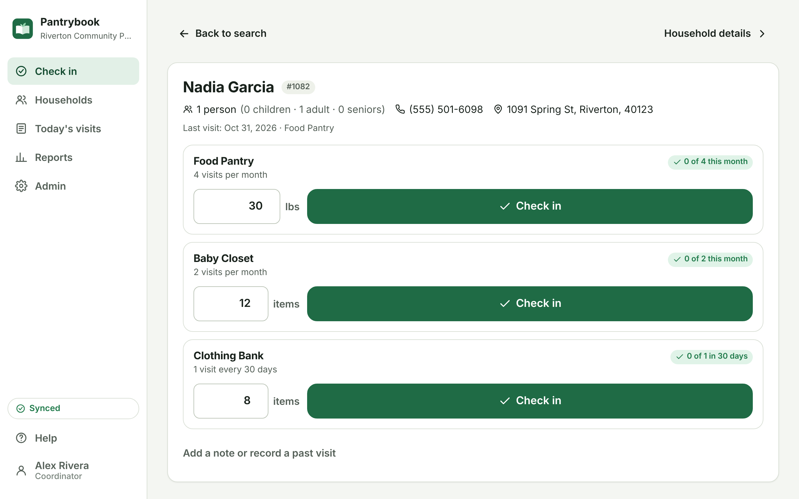
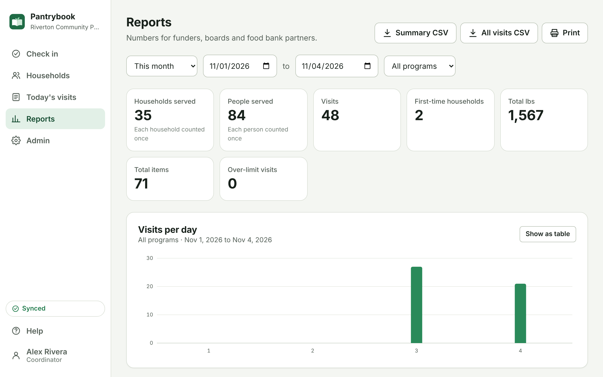
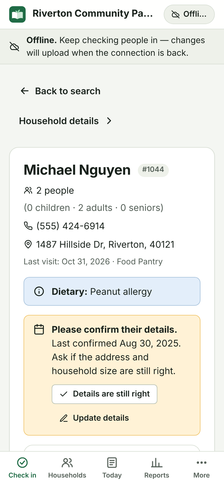

<div align="center">


# Pantrybook

**Free, self-hosted intake and distribution for food pantries, baby closets and clothing banks.**<br />
Register households, check them in, enforce visit limits, and hand funders their numbers —
even when the Wi-Fi drops.

[](https://github.com/lobojoel2003/Pantrybook/actions/workflows/ci.yml)
[](https://github.com/lobojoel2003/Pantrybook/releases)
[](https://github.com/lobojoel2003/Pantrybook/actions/workflows/codeql.yml)
[](LICENSE)
[](https://github.com/lobojoel2003/Pantrybook/pkgs/container/pantrybook)

[Try the demo](#try-it-in-one-minute) · [Deploy](#deploy) · [Volunteer guide](#a-five-minute-volunteer-guide) · [Reports](#reports-for-funders) · [Development](#development)



</div>

## Why Pantrybook

Most small pantries track families in Excel or on paper, because the alternatives cost more than they can spend:

- PantrySoft charges **$50–$125 a month** for one location, plus a **$500–$1,500 setup fee** and about **$1,500 for data migration** ([pricing](https://pantrysoft.com/pricing/)). Link2Feed starts at **$29 per feature per month** ([Capterra](https://www.capterra.com/p/190150/Link2Feed/)).
- A Link2Feed reviewer says it "can't tell us when a family has abused its privilege of 4 visits per month"; another struggles to print an intake form with no internet ([Capterra](https://www.capterra.com/p/190150/Link2Feed/)).
- A small nonprofit asked for something free and self-hosted to track who they help, and a vendor replied "you'll be hard pressed to find purpose built software that's (1) free or (2) self-hosted" ([thread](https://lr.in.psf.lt/r/nonprofit/comments/1dt4s4z/advice_needed_for_software_for_food_pantrylike)).
- Another says off-the-shelf systems are "beyond our budget or require technical capacity that our small team cannot yet support" ([thread](https://techcommunity.microsoft.com/discussions/microsoftfornonprofits/question-for-small-nonprofits/4354891/replies/4472809)).

Pantrybook is the gap filler: **free and open source, one small server (or a Raspberry Pi), works offline, and simple enough for a volunteer to learn in five minutes.**

## Features

|                            |                                                                                                                                                                                                               |
| -------------------------- | ------------------------------------------------------------------------------------------------------------------------------------------------------------------------------------------------------------- |
| **Fast check-in**          | Search by name, phone digits or household number. Each program shows "2 of 4 this month" or the next eligible date. Record pounds or items and undo mistakes with one tap.                                    |
| **Visit limits that work** | Per day, week, month, year or rolling N days, per program. Over-limit visits need a reason and show up on their own report. Choose whether anyone, only coordinators, or nobody can override.                 |
| **Offline first**          | Installs on tablets and phones. Households and recent visits live on the device; check-ins made without internet upload automatically later, and the server re-checks limits when they arrive.                |
| **Simple intake**          | Only a name and household size are required. Children / adults / seniors, contact details, language, dietary needs and self-declared income eligibility (TEFAP) are optional. Duplicate warnings as you type. |
| **Funder reports**         | Unduplicated households and people, age groups, first-time households, pounds per program, ZIP codes, visits per day or month, over-limit visits. CSV export and print.                                       |
| **Paper backup**           | A printable intake form (blank or filled in) and a daily sign-in sheet, for days without power or devices.                                                                                                    |
| **Bring your spreadsheet** | Import households from Excel or Google Sheets (CSV) with automatic column matching and duplicate skipping. No migration fee.                                                                                  |
| **Re-certification**       | Volunteers are reminded to confirm a household's details every 12 months (configurable).                                                                                                                      |
| **Privacy built in**       | Erase a family's details on request while keeping anonymous totals. Devices wipe their copy at sign-out. Everything stays on your server.                                                                     |
| **Easy to run**            | One Docker container with a SQLite file. One-click Render deploy, Docker Compose with automatic HTTPS, Fly.io, or plain Node.js. Built-in backups and CLI.                                                    |

<table>
  <tr>
    <td width="62%"></td>
    <td width="38%"></td>
  </tr>
  <tr>
    <td align="center"><em>Reports for funders</em></td>
    <td align="center"><em>Still checking people in with no connection</em></td>
  </tr>
</table>

## Try it in one minute

With [Docker](https://docs.docker.com/get-docker/) installed:

```bash
docker run --rm -p 3000:3000 -e PANTRYBOOK_DEMO=true ghcr.io/lobojoel2003/pantrybook:latest
```

Open <http://localhost:3000> and sign in as **`admin`** or **`volunteer`** with the password **`pantrybook`**. The demo is a made-up pantry ("Riverton Community Pantry") with 160 households and six months of visits; it resets every 24 hours.

To run a public demo for your volunteers to practise on, deploy [`deploy/render-demo.yaml`](deploy/render-demo.yaml) on Render's free plan.

## Deploy

Pantrybook is a single process with a single SQLite file. A $5–7/month server, an old laptop, or a Raspberry Pi 4 is plenty for a pantry serving thousands of households.

> [!IMPORTANT]
> **Use HTTPS** for offline mode and for installing Pantrybook on tablets and phones; browsers only allow those features on secure sites (or `localhost`). Everything else also works over plain HTTP on your own network.

### Option 1: Render (one click)

[](https://render.com/deploy?repo=https://github.com/lobojoel2003/Pantrybook)

Uses [`render.yaml`](render.yaml): the published image, HTTPS, and a 1 GB persistent disk for the database (Render's Starter plan, about $7/month plus $0.25/month for the disk). When it's live, open the URL and follow the setup screen.

### Option 2: Docker Compose (any server, with automatic HTTPS)

```bash
curl -O https://raw.githubusercontent.com/lobojoel2003/Pantrybook/main/docker-compose.yml
mkdir -p deploy && curl -o deploy/Caddyfile https://raw.githubusercontent.com/lobojoel2003/Pantrybook/main/deploy/Caddyfile
```

Point a domain name at the server, then start Pantrybook with [Caddy](https://caddyserver.com/) in front of it. Caddy fetches the HTTPS certificate on its own:

```bash
DOMAIN=pantry.example.org docker compose --profile https up -d
```

Or, for a private network without a domain name, start Pantrybook alone on port 3000:

```bash
docker compose up -d
```

Data lives in the `pantrybook-data` Docker volume. Update with:

```bash
docker compose pull && docker compose up -d
```

### Option 3: Fly.io

```bash
fly launch --copy-config --no-deploy
fly volumes create pantrybook_data --size 1
fly deploy
```

Uses [`fly.toml`](fly.toml) (a shared-CPU machine with 512 MB of memory that stops when idle).

### Option 4: Raspberry Pi or any Linux box with Docker

The image is built for `amd64` and `arm64`:

```bash
docker run -d --name pantrybook --restart unless-stopped \
  -p 3000:3000 -v pantrybook-data:/data -e TZ=America/Chicago \
  ghcr.io/lobojoel2003/pantrybook:latest
```

### Option 5: Without Docker

Install [Node.js 22.18 or newer](https://nodejs.org/), download `pantrybook-<version>.tar.gz` from the [latest release](https://github.com/lobojoel2003/Pantrybook/releases/latest), and run:

```bash
tar xzf pantrybook-*.tar.gz && cd pantrybook-*/
npm ci --omit=dev --ignore-scripts
PANTRYBOOK_DATA_DIR=/var/lib/pantrybook PORT=3000 node build
```

Use a process manager (systemd, pm2) to keep it running, and put a reverse proxy with HTTPS in front of it.

### First run

Open Pantrybook in a browser. The setup screen asks for your organization's name and creates the first coordinator account. A **Food Pantry** program allowing 4 visits per month is created for you. Then:

1. **Admin → Programs**: adjust limits, add a baby closet, clothing bank, holiday baskets…
2. **Admin → People**: give every volunteer their own login.
3. **Admin → Data**: import your existing spreadsheet.
4. On each tablet, open Pantrybook and choose **Install app** (or **Add to Home Screen** on iPad/iPhone).

## Configuration

All settings are optional environment variables.

| Variable                        | Default                      | What it does                                                                                                                                        |
| ------------------------------- | ---------------------------- | --------------------------------------------------------------------------------------------------------------------------------------------------- |
| `PANTRYBOOK_DATA_DIR`           | `./data` (`/data` in Docker) | Folder for `pantrybook.db`. Put it on persistent storage.                                                                                           |
| `PANTRYBOOK_DEMO`               | `false`                      | Fill an empty database with fictional data and show demo sign-in hints.                                                                             |
| `PANTRYBOOK_DEMO_RESET_HOURS`   | `24`                         | How often demo data is re-seeded (`0` = only at start).                                                                                             |
| `PANTRYBOOK_SESSION_DAYS`       | `30`                         | How long people stay signed in (renewed while they use it).                                                                                         |
| `PANTRYBOOK_OFFLINE_VISIT_DAYS` | `400`                        | Days of visit history each device keeps for offline limit checks.                                                                                   |
| `PANTRYBOOK_SECURE_COOKIES`     | auto                         | Force the session cookie's `Secure` flag on (`true`) or off (`false`).                                                                              |
| `PORT` / `HOST`                 | `3000` / `0.0.0.0`           | Where the web server listens.                                                                                                                       |
| `PROTOCOL_HEADER`               | —                            | Behind an HTTPS proxy: `x-forwarded-proto`.                                                                                                         |
| `HOST_HEADER`                   | —                            | Behind a proxy that rewrites the host: `x-forwarded-host`.                                                                                          |
| `ADDRESS_HEADER` / `XFF_DEPTH`  | —                            | Header with the visitor's IP (for example `x-forwarded-for` or `fly-client-ip`), so failed sign-ins are throttled per device rather than per proxy. |
| `BODY_SIZE_LIMIT`               | `512K` (`10M` in Docker)     | Largest request accepted.                                                                                                                           |
| `TZ`                            | system                       | Server time zone, used for demo data and logs.                                                                                                      |

The web-server variables come from [`@sveltejs/adapter-node`](https://svelte.dev/docs/kit/adapter-node). Organization name, override policy, the first day of the week and re-certification are set in the app under **Admin → Settings**.

## Backups, restore and upgrades

- **Download a backup** any time from **Admin → Data → Download full backup**. It is one `.db` file containing everything; keep it private, since it holds families' personal information.
- **Scheduled backups**: copy the file the CLI writes, for example nightly with cron:

  ```bash
  docker exec -u node pantrybook node scripts/cli.ts backup /data/backup-$(date +%F).db
  ```

- **Restore**: stop Pantrybook, then run `node scripts/cli.ts restore <file.db>` (in Docker: `docker run --rm -v pantrybook-data:/data -v "$PWD":/backup ghcr.io/lobojoel2003/pantrybook node scripts/cli.ts restore /backup/<file.db>`), and start it again. Every device notices the restore and downloads a fresh copy.
- **Upgrades**: pull the new image (or unpack the new release) and restart. Database changes are applied automatically at start-up. Back up first.

### Admin command line

```text
node scripts/cli.ts info                         Database location and counts
node scripts/cli.ts create-admin <user> [name]   Create a coordinator account
node scripts/cli.ts reset-password <user>        Set a new password (prompts, or uses PANTRYBOOK_PASSWORD)
node scripts/cli.ts backup <file.db>             Consistent copy of the database
node scripts/cli.ts restore <file.db>            Replace the database with a backup (server stopped)
node scripts/cli.ts seed-demo [--force]          Fill the database with fictional data
```

In Docker, prefix with `docker exec -it -u node pantrybook`. Locked out? `reset-password` always works from the server.

## A five-minute volunteer guide

The same guide is built into the app under **Help**.

1. **Check someone in**: type part of their name, phone number or household number, tap their name, enter the amount, tap **Check in**. Tap **Undo** if you picked the wrong family.
2. **New family**: tap **New household**. Name and number of people are enough. If a yellow box says they might already be registered, check before saving.
3. **Limit reached?** The program turns red and shows when they can come back. If your pantry allows it, tap **Check in anyway** and give a reason.
4. **No internet?** Keep going. A grey _Offline_ bar appears and changes upload by themselves when the connection is back.
5. **No device or power?** Print the paper intake form and the day's sign-in sheet ahead of time.

## How offline mode works

```text
 Tablet / phone (browser)                                Server
 ┌───────────────────────────────────────┐              ┌─────────────────────────────┐
 │ Service worker: the app itself        │              │ SvelteKit + adapter-node    │
 │ IndexedDB: households, recent visits, │  push queue  │ /api/sync                   │
 │   programs, settings                  │ ───────────▶ │  · applies changes in order │
 │ Outbox: changes not uploaded yet      │              │  · re-checks visit limits   │
 │                                       │ ◀─────────── │  · assigns household #s     │
 │ Search, limits, check-in run locally  │ pull changes │ SQLite (one file, WAL)      │
 └───────────────────────────────────────┘  since rev N └─────────────────────────────┘
```

- **Every change is recorded on the device first**, then queued. When online, the queue uploads within a second; otherwise it waits and retries every 30 seconds and whenever the connection returns.
- **Downloads are incremental.** Every row has a change number (`rev`); devices ask for "everything after N", so a sync after the first one moves only what changed.
- **Conflicts**: a check-in is never lost; visits are only ever added or voided. If two devices edit the same household, the most recent edit wins. Limits are re-checked on the server, so two volunteers checking in the same family on two offline tablets still produces an over-limit flag for the coordinator.
- **Each device keeps** all households and the last ~400 days of visits (enough for yearly limits). Older history loads on demand.
- **Shared devices**: signing out removes the data from the device. Changes that haven't uploaded stay queued and upload when the same person signs in again.

## Reports for funders

| Measure                      | Meaning                                                                               |
| ---------------------------- | ------------------------------------------------------------------------------------- |
| Households served            | Each household counted once in the period.                                            |
| People served (unduplicated) | Each household's size counted once, using its size at its latest visit in the period. |
| People served (duplicated)   | Household size added up for every visit (what some programs, such as TEFAP, ask for). |
| Children / adults / seniors  | Ages 0–17, 18–64 and 65+, unduplicated.                                               |
| First-time households        | Households whose first-ever visit falls in the period.                                |
| Amount distributed           | Sum of pounds, items or bags recorded per program.                                    |
| Over-limit visits            | Visits beyond a program's limit, with who recorded them and why.                      |

All counts ignore removed (voided) visits. **Summary CSV** produces a funder-ready table; coordinators can also download **every visit** as CSV for their own spreadsheets.

## Security and privacy

- Passwords are hashed with scrypt; sessions are random tokens stored hashed, in `HttpOnly`, `SameSite=Lax` cookies.
- Repeated failed sign-ins are throttled. Coordinators can turn accounts off, which signs them out everywhere.
- The API only accepts JSON for changes, which blocks cross-site request forgery; pages ship a strict Content-Security-Policy and other security headers.
- CSV exports neutralise spreadsheet formulas. Exports, backups, deletions and account changes are recorded in the admin activity log.
- No analytics, no external fonts or scripts, nothing leaves your server.

Please report vulnerabilities privately; see [SECURITY.md](SECURITY.md).

## Development

Requirements: Node.js 22.18+ and npm.

```bash
git clone https://github.com/lobojoel2003/Pantrybook.git
cd Pantrybook
npm install
npm run seed:demo      # optional: fictional data in ./data
npm run dev            # http://localhost:5173
```

| Command                           | What it does                                                                                                                                  |
| --------------------------------- | --------------------------------------------------------------------------------------------------------------------------------------------- |
| `npm run dev`                     | Development server with hot reload.                                                                                                           |
| `npm run build` / `npm start`     | Production build in `build/`, then run it.                                                                                                    |
| `npm run check`                   | Type-check Svelte, TypeScript and the service worker.                                                                                         |
| `npm run lint` / `npm run format` | Prettier + ESLint.                                                                                                                            |
| `npm test`                        | Unit tests (Vitest).                                                                                                                          |
| `npm run test:e2e`                | Build, then end-to-end tests in Chromium (Playwright), including offline check-in and sync. Run `npx playwright install chromium` once first. |
| `npm run cli -- <command>`        | The admin CLI against `./data`.                                                                                                               |
| `npm run icons`                   | Regenerate PNG icons from `static/favicon.svg`.                                                                                               |

**Stack**: [SvelteKit 3](https://svelte.dev/docs/kit) and Svelte 5 (runes), TypeScript, [better-sqlite3](https://github.com/WiseLibs/better-sqlite3), [idb](https://github.com/jakearchibald/idb), [Zod](https://zod.dev), Vite 8, Vitest, Playwright. No CSS framework and no UI library: plain CSS with design tokens and a dark mode.

```text
src/
  lib/shared/      Pure logic used by browser and server: limits, dates, CSV, search, types
  lib/server/      Database, migrations, auth, sync, reports, import, demo data
  lib/client/      Offline store (IndexedDB), sync engine, toasts, install/update handling
  lib/components/  Check-in panel, household form, chart, dialogs…
  routes/          Pages (rendered in the browser) and the JSON API under routes/api
  service-worker/  Keeps the app available offline
scripts/           Admin CLI, icon generator, release helpers
tests/e2e/         Playwright tests
deploy/            Docker entrypoint, Caddyfile, Render demo blueprint
```

### Versioning and releases

Pantrybook follows [Semantic Versioning](https://semver.org/). Every build is stamped with three things, visible under **Account**, at **Admin → Data**, and from `GET /api/health`:

- **Version**: from `package.json`, for example `1.0.0`.
- **Build number**: the number of commits up to that point, so it always increases and is the same wherever a commit is built (laptop, CI, Docker, release).
- **Commit**: the short git SHA.

To cut a release, add notes under `## [Unreleased]` in [CHANGELOG.md](CHANGELOG.md), then:

```bash
npm version minor      # or patch / major: updates package.json + CHANGELOG, commits, tags vX.Y.Z
git push --follow-tags
```

The [release workflow](.github/workflows/release.yml) then runs every check, publishes multi-arch images to GHCR (`X.Y.Z`, `X.Y`, `X`, `latest`) with an SBOM and signed provenance, builds `.tar.gz` and `.zip` bundles with `SHA256SUMS`, and creates the GitHub Release from the changelog. Pushes to `main` publish an `edge` image.

### Continuous integration

Every push and pull request runs lint, type-checks, unit tests on Node 22 and 24, a production build with the end-to-end suite, and a Docker build with a smoke test. CodeQL scans the code weekly and on every change, and Dependabot keeps npm packages, GitHub Actions and the base image current.

## Roadmap

Ideas for future versions (contributions welcome):

- Spanish and other languages for the volunteer screens.
- Per-member records with dates of birth, for programs that need ages.
- Appointment scheduling and text-message reminders.
- Inventory and donation tracking.
- More report formats (TEFAP monthly form, Feeding America agency reports).

## Contributing

Bug reports, ideas and pull requests are welcome. Please read [CONTRIBUTING.md](CONTRIBUTING.md) and our [Code of Conduct](CODE_OF_CONDUCT.md). If you run Pantrybook at a pantry, we'd love to hear what works and what doesn't.

## License

[GNU Affero General Public License v3.0](LICENSE). You can use, change and share Pantrybook for free. If you offer a modified version to others over a network, share your changes under the same license.
